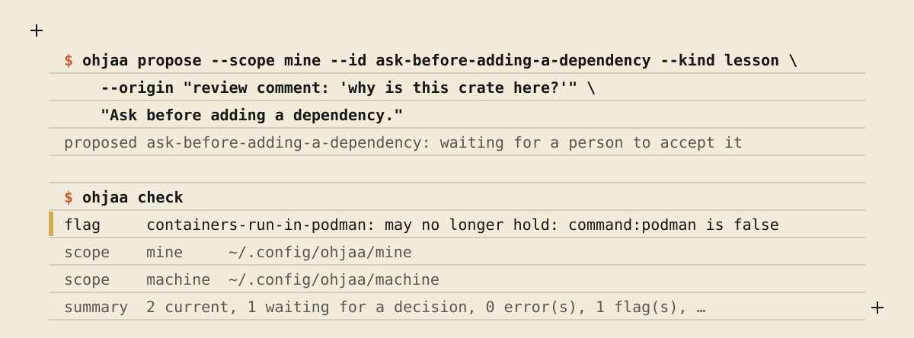
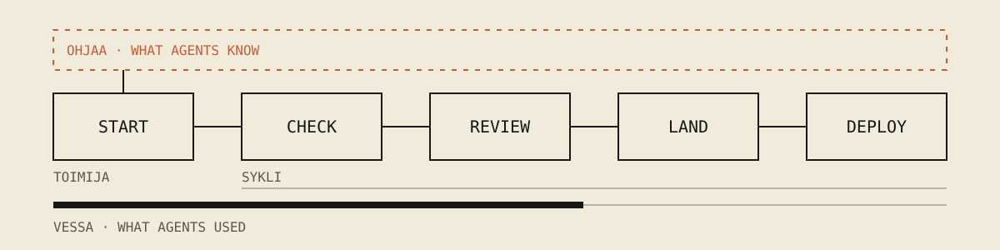

# ohjaa

Ohjaa is a local command-line tool that keeps what a person and their team
have decided and learned as small knowledge files, and writes the current
ones into each coding agent's own instruction file. *Ohjaa* is Finnish for
*steer*.

It is for someone who works with coding agents such as Claude Code, Codex, pi
or opencode and is tired of giving each one the same correction again. You
need git, Rust to install it from source, and at least one agent CLI.

Coding agents start every session knowing nothing about your world: which
languages you use, where builds run, what you already said no to. So you
correct them, and then you correct the next one the same way. A correction
you have to repeat is knowledge that did not reach the agent. Ohjaa holds
that knowledge in one place, as decisions, facts, taste and lessons, and
delivers it to Claude Code, Codex, pi and opencode alike, so every agent
starts from the same rules. Anyone can propose knowledge, an agent included.
Only a person at a terminal makes it current.

## See it



An agent proposes a lesson. `ohjaa check` then validates the knowledge, and
flags a fact whose condition is no longer true on this machine.

<details><summary>The same, as text</summary>

```console
$ ohjaa propose --scope mine --id ask-before-adding-a-dependency --kind lesson \
    --origin "review comment: 'why is this crate here?'" \
    "Ask before adding a dependency."
proposed ask-before-adding-a-dependency: waiting for a person to accept it
ohjaa: ~/.local/state/ohjaa/proposals/mine/ask-before-adding-a-dependency.md

$ ohjaa check
flag     containers-run-in-podman: may no longer hold: command:podman is false
scope    ours     (no home here)
scope    repo     (no home here)
scope    mine     ~/.config/ohjaa/mine
scope    machine  ~/.config/ohjaa/machine
summary  2 current, 1 waiting for a decision, 0 error(s), 1 flag(s), briefing 599/8000
```

</details>

The proposal waits outside every repository until a person runs
`ohjaa review`.

## Install

Ohjaa runs on macOS and Linux. Windows is not supported: under WSL it runs as
the Linux program, beside agents that run inside WSL.

Today ohjaa builds from source with cargo. It needs the Rust toolchain named
in `rust-toolchain.toml` (1.98, with rustfmt and clippy); rustup installs it
by itself when you build.

```bash
git clone https://github.com/false-systems/ohjaa
cd ohjaa
cargo install --path .
```

Ohjaa is not on crates.io yet. Once it is published, `cargo install ohjaa`
installs it with Rust 1.98 or newer; until then, use the commands above.

No release is published yet. Once one is, this line installs a prebuilt
binary to `~/.local/bin` after checking it against the release's checksums,
with `v<version>` being the release's tag:

```bash
curl -fsSL https://raw.githubusercontent.com/false-systems/ohjaa/main/install.sh | sh -s -- v<version>
```

Ohjaa also needs `git`. `ohjaa brief` asks `toimija`, when it is there, who
is working where. Ohjaa makes no network call.

## Use

A 60-second start:

```bash
# Propose your first rule. It waits; nothing is told to an agent yet.
ohjaa propose --scope mine --id code-is-rust --kind decision \
    --origin "we keep one language" "Code is Rust. Ask before adding another."
ohjaa review           # accept it: only a person at a terminal can
ohjaa apply --dry-run  # see what would go into each agent's instruction file
ohjaa apply            # write it; `ohjaa apply --undo` takes it all back
```

The commands, in the order a person meets them:

- `ohjaa apply`: write the current knowledge into each agent's own
  instruction file. `--dry-run` shows every change first; `--undo` takes it
  all back.
- `ohjaa propose --scope mine --id <id> --kind lesson --origin "<why>" "<text>"`:
  propose knowledge. It waits until a person decides.
- `ohjaa review`: go through the proposals, one at a time, and accept or
  dismiss each. Only a person at a terminal can.
- `ohjaa list`: the knowledge that applies where you are.
- `ohjaa check`: validate every entry, and flag what may no longer hold.
- `ohjaa lessons`: write a repository's lessons into its `AGENTS.md`, in the
  working copy you run it in, for you to commit and push like any change.
- `ohjaa brief`: the briefing an agent gets in this repository.
- `ohjaa doctor`: what differs from what `apply` would make it.

`ohjaa <command> --help` describes each one, with its exit codes.
[docs/reference.md](docs/reference.md) has the detail.

## How it fits

Ohjaa is one of four small tools for working with coding agents. Each one works
alone.



- **toimija** starts the session and gives the agent the facts of the repository.
- **sykli** runs the declared checks, keeps the proof, and reviews, lands and deploys the work.
- **ohjaa** holds what agents are told. A person decides it.
- **vessa** counts what agents used.

[Your first loop](https://github.com/false-systems/toimija/blob/main/docs/first-loop.md) walks one change through all four tools.

## What it does not do

- It runs no agents and no sessions. Agents start as you start them, and
  read the knowledge from their own instruction files.
- It runs no checks and blocks no commit or push.
- It carries no messages between agents, and assigns no work to them.
- It sends nothing anywhere: no pull request, no network call. What it
  writes into a repository is in your working copy, for you to read and
  commit.
- It cannot stop a determined agent from accepting its own proposal. The
  terminal check stops a careless one; a program can fake a terminal.

## More

- [Reference](docs/reference.md): every command, the file formats, and where ohjaa keeps what.
- [Knowledge file format](docs/knowledge-node-v1.md): what one piece of knowledge looks like on disk.
- [Ontology](docs/ontology.md): what the concepts mean.
- [Agent guide](AGENTS.md): for agents that work on ohjaa itself.
- [Licence](LICENSE): MIT.

<p align="center"><sub>Part of <a href="https://false-systems.com">False Systems</a> · computing as craft</sub></p>
