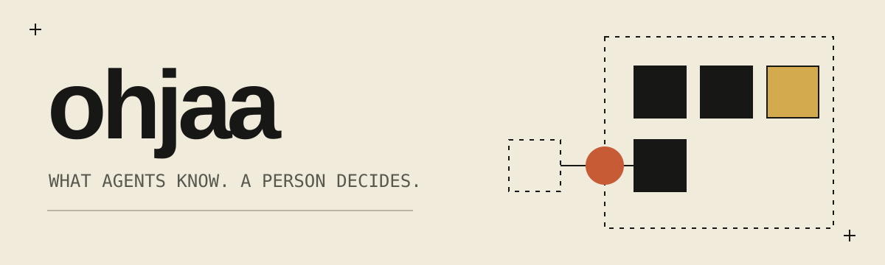

# ohjaa

Ohjaa is a local command-line tool that keeps what a person and their team
have decided and learned as small knowledge files, and writes the current
ones into each coding agent's own instruction file. *Ohjaa* is Finnish for
*steer*.

Coding agents start every session knowing nothing about your world: which
languages you use, where builds run, what you already said no to. So you
correct them, and then you correct the next one the same way. A correction
you have to repeat is knowledge that did not reach the agent. Ohjaa holds
that knowledge in one place, as decisions, facts, taste and lessons, and
delivers it to Claude Code, Codex, pi and opencode alike, so every agent
starts from the same rules. Anyone can propose knowledge, an agent included.
Only a person at a terminal makes it current.

## See it

An agent proposes a lesson. `ohjaa check` then validates the knowledge, and
flags a fact whose condition is no longer true on this machine:

```console
$ ohjaa propose --scope mine --id ask-before-adding-a-dependency --kind lesson \
    --origin "review comment: 'why is this crate here?'" \
    "Ask before adding a dependency."
proposed ask-before-adding-a-dependency: waiting for a person to accept it

$ ohjaa check
flag     containers-run-in-podman: may no longer hold: command:podman is false
evidence no intake has run here: how often each was re-taught is unknown, not zero (`ohjaa intake`)
evidence code-is-rust: re-taught 0 times since 2026-11-10
evidence containers-run-in-podman: re-taught 0 times since 2026-11-10
scope    mine     ~/.config/ohjaa/mine
scope    machine  ~/.config/ohjaa/machine
summary  2 current, 1 waiting for a decision, 0 error(s), 1 flag(s), 0 suggestion(s), briefing 608/8000
```

The proposal waits outside every repository until a person runs
`ohjaa review`.

## Install

Ohjaa builds from source with cargo. It needs the Rust toolchain named in
`rust-toolchain.toml` (1.98, with rustfmt and clippy); rustup installs it by
itself when you build. It runs on macOS and Linux.

```bash
git clone https://github.com/false-systems/ohjaa
cd ohjaa
cargo install --path .
```

Ohjaa also needs `git`. Some commands call other programs when they are
there: `gh` to read pull requests and to deliver a repository's lessons,
`vessa` to read what people wrote in agent sessions, `toimija` to say who is
working where, and an agent CLI such as `claude -p` to draft proposals.

## Use

In the order a person meets them:

- `ohjaa apply`: write the current knowledge into each agent's own
  instruction file. `--dry-run` shows every change first; `--undo` takes it
  all back.
- `ohjaa propose --scope mine --id <id> --kind lesson --origin "<why>" "<text>"`:
  propose knowledge. It waits until a person decides.
- `ohjaa review`: go through the proposals, one at a time, and accept or
  dismiss each. Only a person at a terminal can.
- `ohjaa list`: the knowledge that applies where you are, and how often each
  entry had to be taught again.
- `ohjaa check`: validate every entry, and flag what may no longer hold.
- `ohjaa intake`: draft proposals from what people said in agent sessions,
  on pull requests and by reverting commits.
- `ohjaa digest`: for the person, what needs attention and what happened
  since they last looked. `ohjaa line` is its short form for a terminal's
  opening.

`ohjaa <command> --help` describes each one, with its exit codes.
[docs/reference.md](docs/reference.md) has the detail.

## How it fits

Ohjaa is one of a family of small tools for working with coding agents. Each
one works alone.

- **toimija**: facts about a repository, for agents.
- **sykli**: declared checks, and proof that they passed.
- **ohjaa**: what agents are told, decided by a person.
- **vessa**: what agents used.
- **faija**: the words they share.

## What it does not do

- It runs no agents and no sessions. Agents start as you start them, and
  read the knowledge from their own instruction files.
- It runs no checks and blocks no commit or push.
- It carries no messages between agents, and assigns no work to them.
- It cannot stop a determined agent from accepting its own proposal. The
  terminal check stops a careless one; a program can fake a terminal.
- It removes secret-looking tokens before text goes to the drafter, by
  known shapes only. A short password gets through.

## More

- [docs/reference.md](docs/reference.md): every command, the file formats,
  and where ohjaa keeps what.
- [AGENTS.md](AGENTS.md): the guide for coding agents working on ohjaa.
- [LICENSE](LICENSE): Apache-2.0.
